# Baton+ 퇴사·휴직 인수인계 서비스

> 자사 서비스 · 2026.07 ~ 운영 중 · 정부 지원사업(사업화과제해결지원금) 선정 
> 서비스 [baton.2bee.dev](https://baton.2bee.dev) · 랜딩 [contix.io](https://www.contix.io)

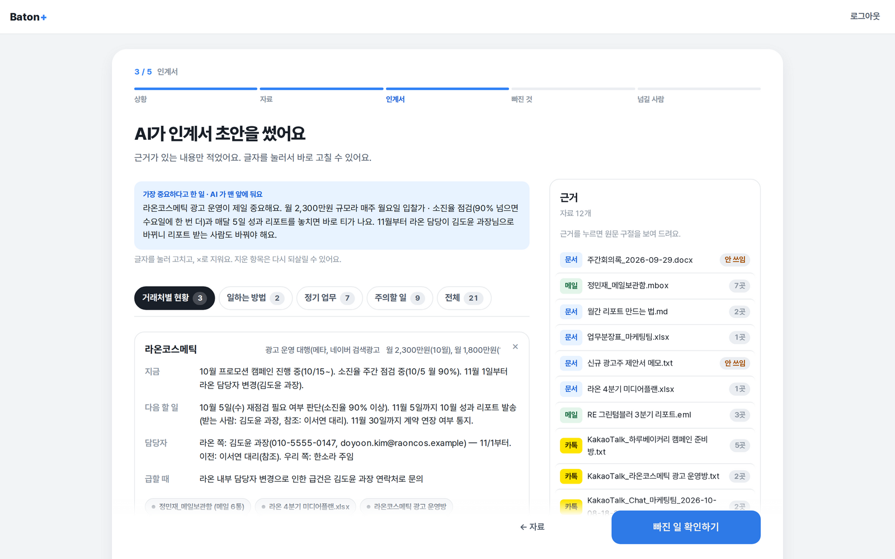

인수인계서는 보통 퇴사나 휴직 직전, 가장 바쁘고 덜 꼼꼼할 때 쓰입니다. 직접 진행한 설문에서 인수인계를 겪어 본 44명 중 90.9%가 인수인계 뒤 다시 일을 확인하거나 처음부터 해야 했다고 답했습니다.

Baton+는 떠나는 사람(인계자)이 평소 쓰던 문서, 메일, 카카오톡 대화를 올리면 AI가 인계서 초안을 만들고, 인계서에서 빠진 일을 찾아 떠나기 전에 물어봅니다. 받는 사람(인수자)은 인계서를 읽고, 근거가 붙은 AI 답변으로 궁금한 걸 묻고, 자료에 없는 건 팀장에게 남깁니다.

기획부터 백엔드, 프론트엔드, 배포와 운영까지 혼자 만들었습니다.

화면에 나오는 회사, 사람, 연락처는 시연용으로 만든 가상 데이터입니다.

---

## 기술 스택

| 구분 | 기술 |
| --- | --- |
| Backend | Java 21, Spring Boot 3.5, Spring Security, JWT |
| Database | PostgreSQL, pgvector, Flyway (마이그레이션 51건) |
| Frontend | React 18, TypeScript, Vite |
| AI | Claude API (인계서 생성, 누락 점검, 근거 기반 답변) |
| 파일 처리 | Apache Tika, 카카오톡 내보내기 파서(직접 구현) |
| Infra | Oracle Cloud, Docker Compose, Cloudflare Tunnel, AWS SES |
| 테스트 | JUnit 410건, 셸 기반 통합 시나리오 23종(검사 약 1,100건), Playwright |

---

## 서비스 흐름

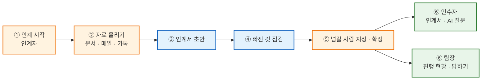

인계 하나가 하나의 인계 공간입니다. 확정 전에는 인계자만 보고, 확정한 뒤에는 초대받은 사람만 봅니다. 보관 기간이 지나면 자동으로 지워집니다.

---

## 화면으로 보는 기능

### 1. 자료 올리기

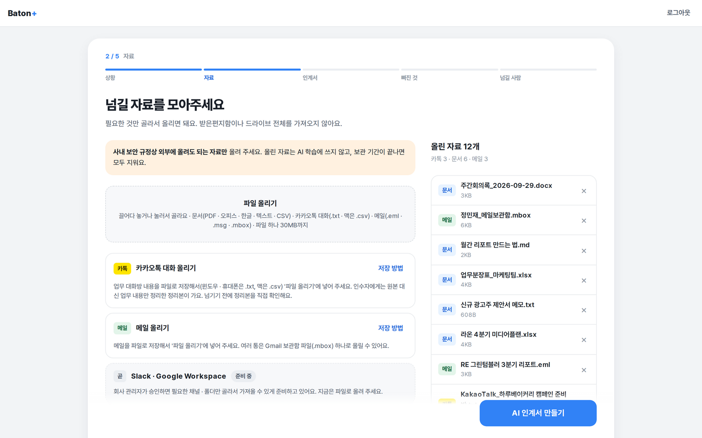

인계자가 업무 자료를 골라 올립니다. 문서, 메일, 카카오톡 대화를 한 화면에서 받습니다.

- PDF, 오피스 문서, 한글, 메일 보관함(.eml, .mbox, Outlook .msg)은 Apache Tika로 읽습니다.
- 카카오톡은 공식 API가 없어서 내보내기 파일 파서를 직접 만들었습니다. 윈도우(txt)와 맥(csv) 형식이 달라 둘 다 읽게 했습니다.
- 파일 형식은 확장자가 아니라 파일 앞부분 내용으로 판별합니다. 이름만 바꾼 실행 파일이나 압축 파일은 받지 않습니다.

### 2. AI 인계서 초안

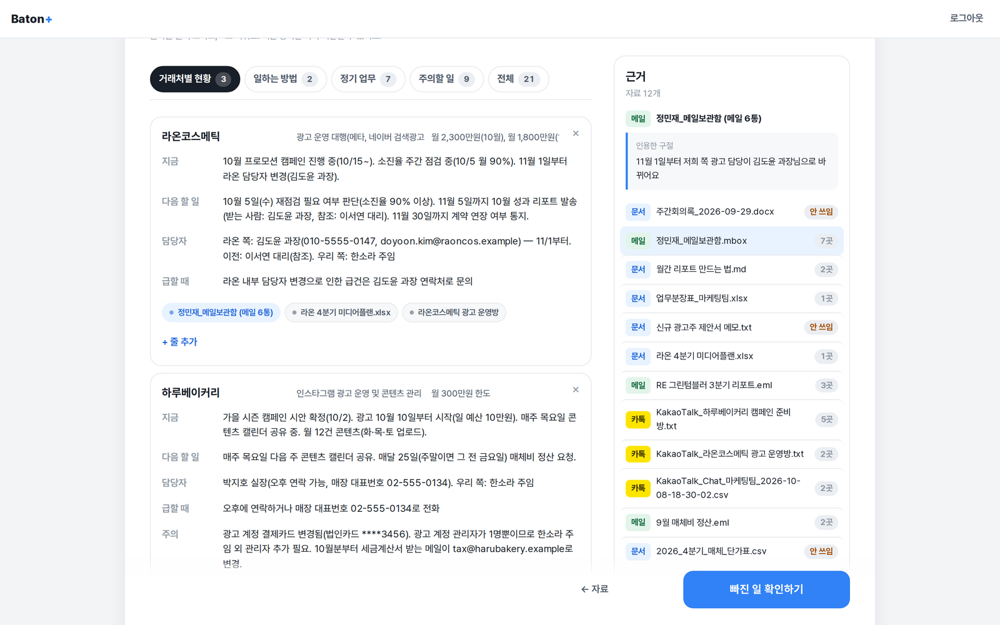

올린 자료를 Claude API로 읽어 거래처별 현황, 일하는 방법, 정기 업무, 주의할 일로 나눠 씁니다. 항목마다 어느 자료의 어느 구절에서 나왔는지 근거가 붙고, 누르면 원문 구절을 보여 줍니다.

AI가 적은 근거 구절은 그대로 믿지 않고, 원문에 실제로 있는지 코드로 다시 확인합니다. 원문에 없는 근거는 버립니다.

### 3. 빠진 것 점검

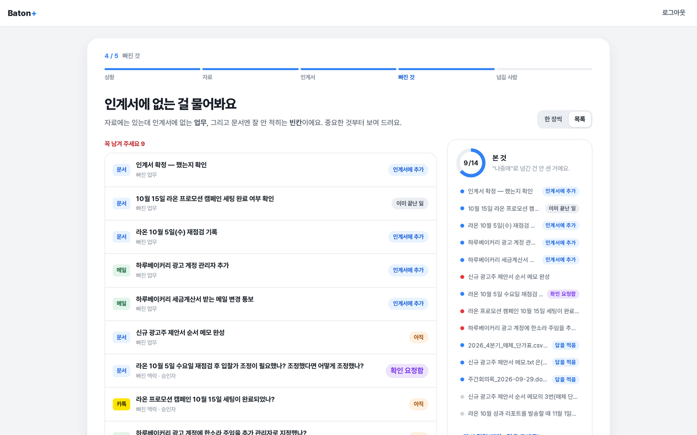

이 서비스에서 가장 공을 들인 부분입니다. 자료를 AI에 넣으면 요약은 해 주지만, 무엇이 빠졌는지는 알려 주지 않습니다.

- 인계서에 없는 업무와, 승인자나 급할 때 연락처처럼 문서엔 잘 안 적히는 맥락을 찾아 인계자에게 묻습니다.
- 회의록의 할 일 표는 코드로 직접 읽어 기한이 지난 항목을 찾습니다. 처음에는 AI에게 맡겼는데, 실행할 때마다 표의 줄을 빠뜨리기도 하고 거래처 쪽 결재가 났다는 말을 우리 쪽 결재가 끝난 것으로 착각하기도 했습니다.
- 완료됐다는 말은 담당자 본인이 한 말일 때만 인정합니다. 대화면 말한 사람을, 메일이면 보낸 사람을 확인합니다.
- 인계자는 한 장씩 넘기며 "인계서에 추가", "이미 끝난 일" 같은 빠른 답으로 채웁니다. 모르는 건 팀장에게 넘깁니다.

### 4. 화면 캡처로 일하는 방법 남기기

  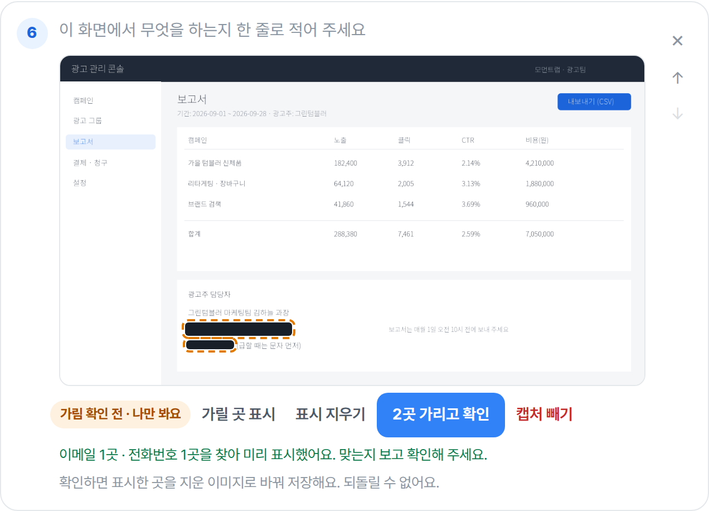
  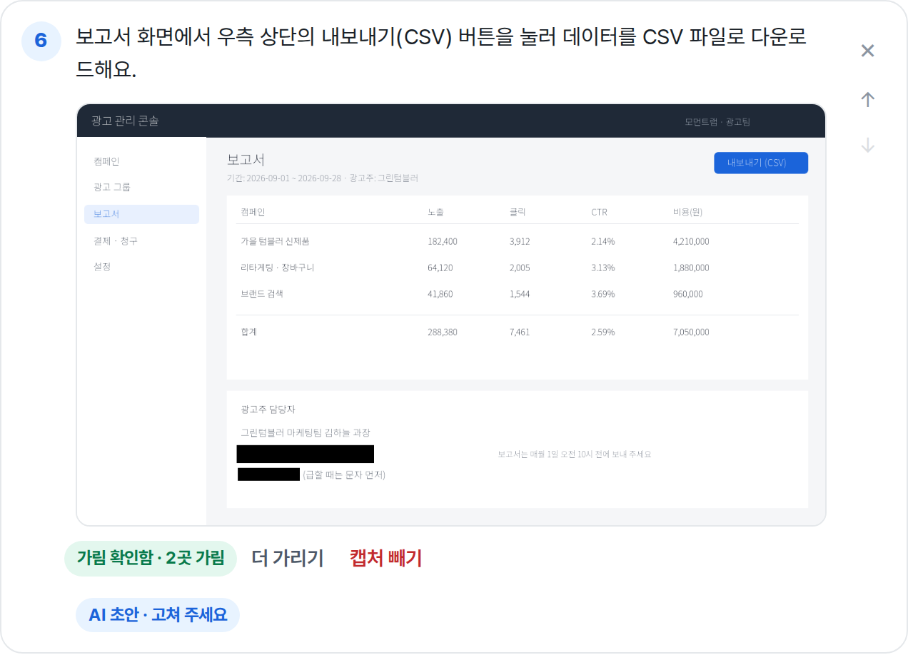

업무 화면 캡처를 붙이면 이메일, 전화번호 같은 개인정보를 미리 찾아 표시합니다. 인계자가 확인하고 가리면 가린 이미지로 바꿔 저장하고, AI가 그 화면에서 무엇을 하는지 한 줄 설명을 제안합니다.

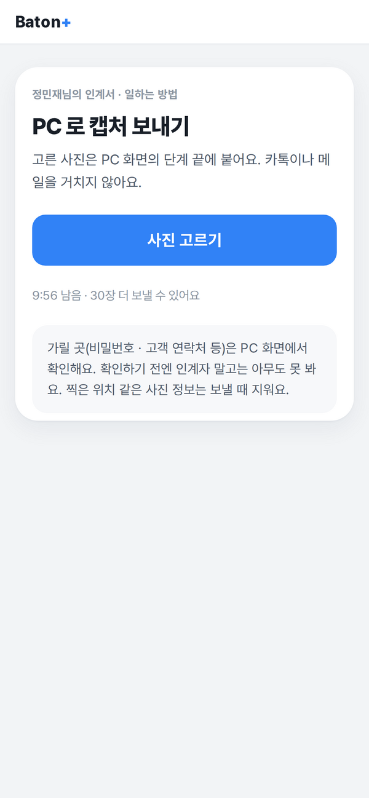

PC 화면 밖의 것(종이 메모, 사내 시스템 화면 등)은 QR을 찍어 휴대폰으로 바로 보낼 수 있습니다. 휴대폰용 링크는 로그인 없이 쓰는 대신 10분 동안만 열리고, PC에서 닫으면 바로 막힙니다. 틀린 링크를 계속 보내는 곳은 차단합니다.

 

### 5. 카카오톡 정리본

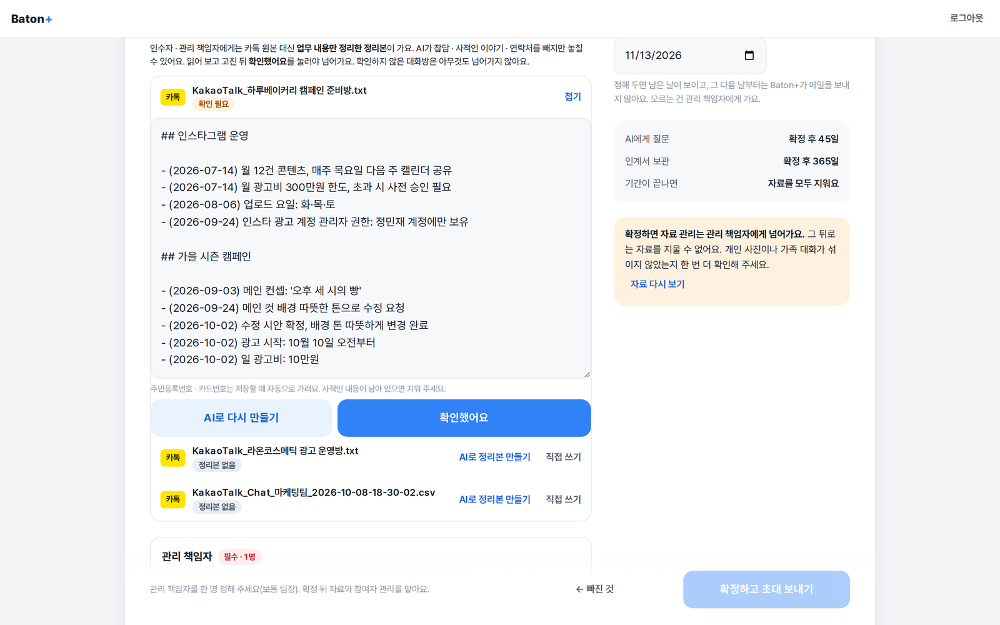

카카오톡 대화에는 업무와 사적인 이야기가 섞여 있습니다. 그래서 인수자에게는 원본 대신 AI가 업무 내용만 추린 정리본을 보여 줍니다. AI가 놓칠 수 있어서, 인계자가 읽고 고친 뒤 "확인했어요"를 눌러야 넘어갑니다. 저장할 때 주민등록번호와 카드번호 모양은 코드로 한 번 더 가립니다.

### 6. 인수자 화면

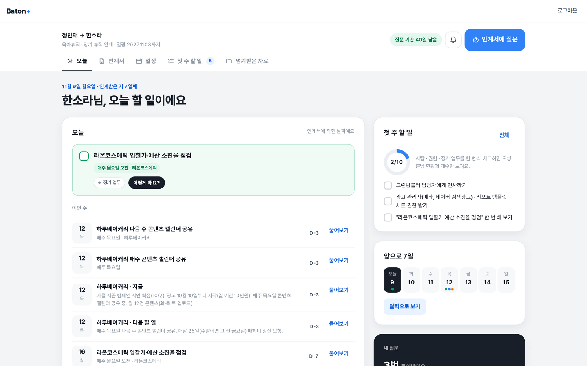

인수자는 인계서에서 날짜가 있는 일을 뽑아 오늘 할 일, 이번 주 일정, 첫 주에 할 일로 봅니다. 일마다 "어떻게 해요?"를 누르면 그 일에 대해 AI에게 바로 물어볼 수 있습니다.

  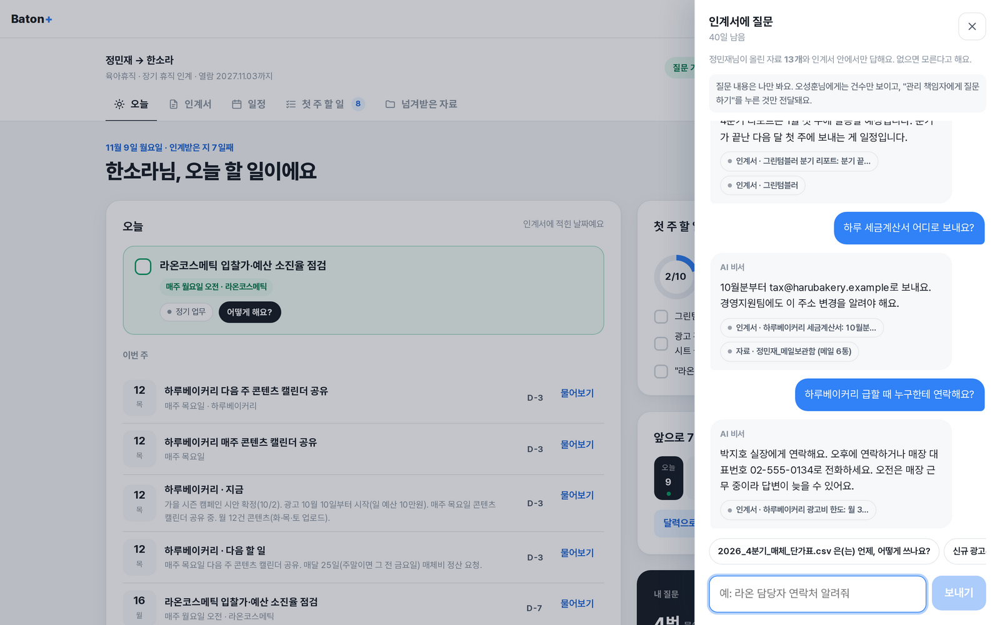
  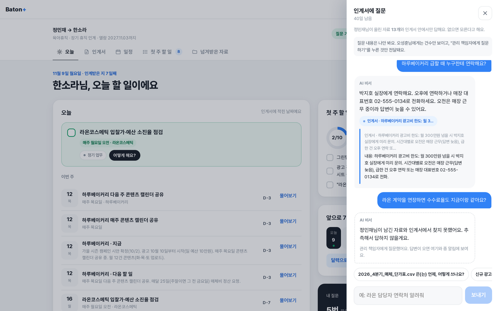

질문하면 인계서와 자료 안에서만 찾아 근거와 함께 답합니다. 자료에 없으면 지어내지 않고 모른다고 답한 뒤, 관리 책임자(보통 팀장)에게 질문을 넘길 수 있게 합니다. 팀장이 답하면 그 답이 다음 질문부터 근거로 쓰입니다.

### 7. 팀장 화면

  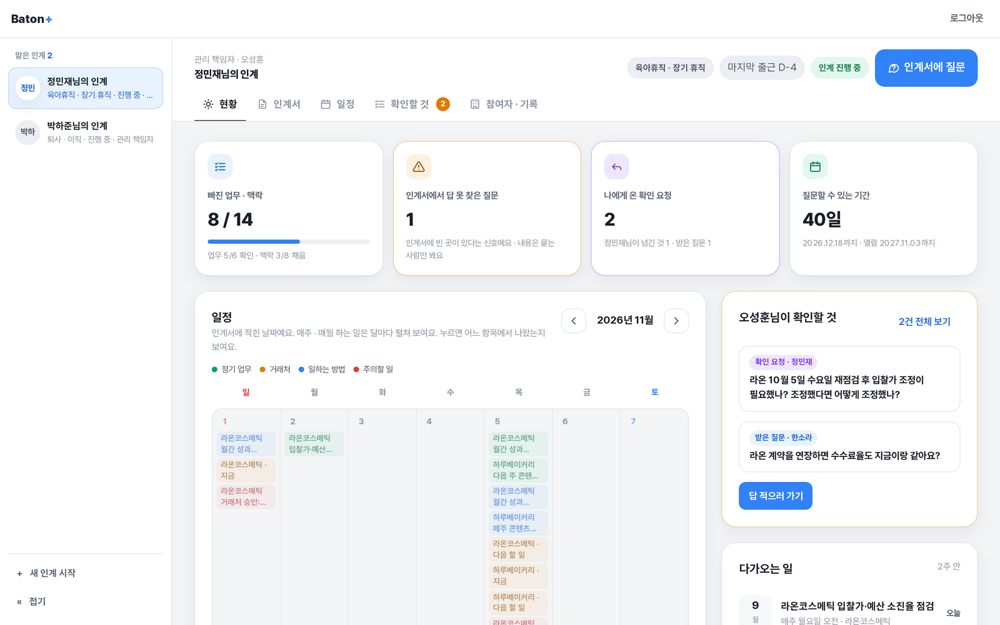
  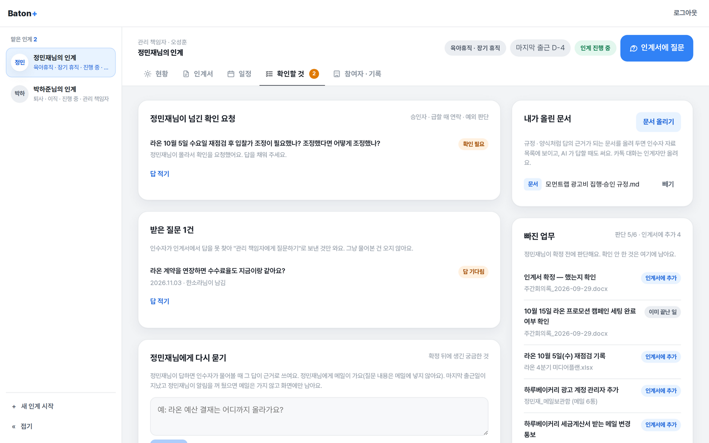

인수인계가 잘못됐을 때 가장 곤란한 사람은 남아 있는 팀장입니다. 팀장은 맡은 인계마다 빠진 것을 얼마나 채웠는지, 인수자가 답을 못 찾은 질문이 몇 건인지, 자기에게 온 확인 요청이 무엇인지를 한 화면에서 봅니다. 인수자가 무엇을 물었는지는 보이지 않고, 건수와 넘겨받은 질문만 보입니다.

### 8. 확정한 뒤에도 이어 쓰기

  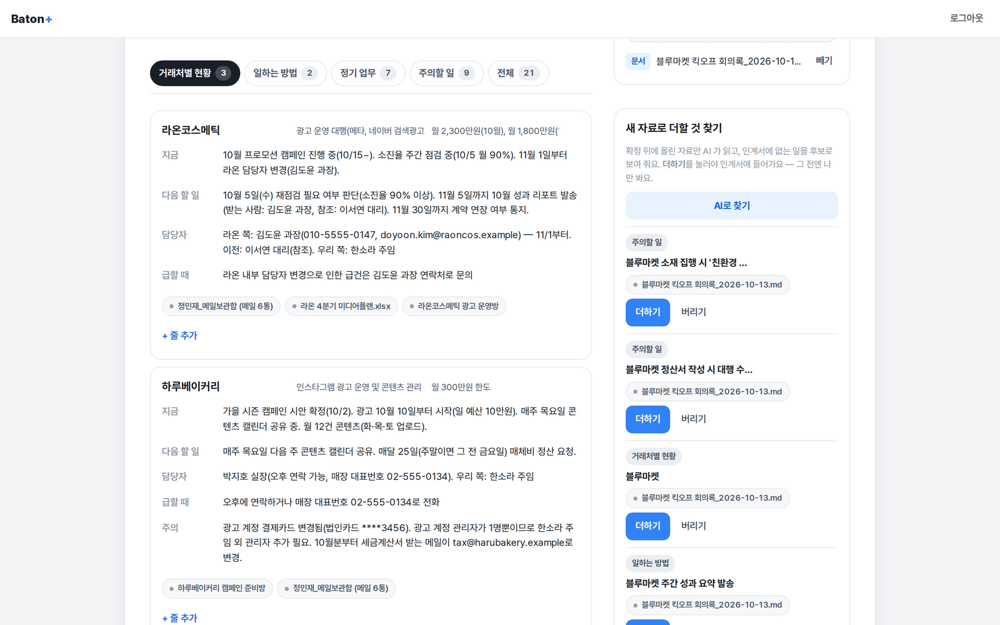
  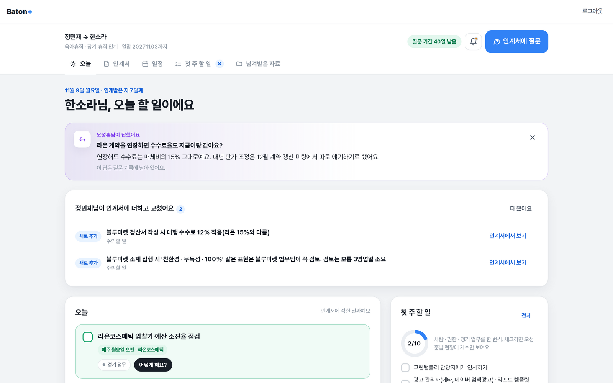

인계자는 확정한 뒤에도 마지막 출근일까지 일을 계속합니다. 그동안 생긴 회의록 같은 새 자료를 올리면 AI가 인계서에 더할 후보를 찾고, 인계자가 고른 것만 들어갑니다. 인수자 화면에는 "새로 추가"로 표시됩니다.

### 9. 휴대폰

  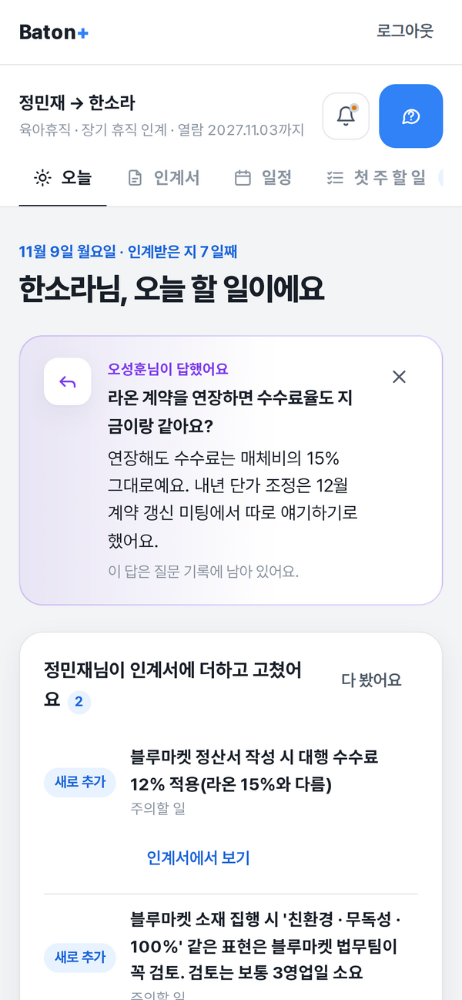
  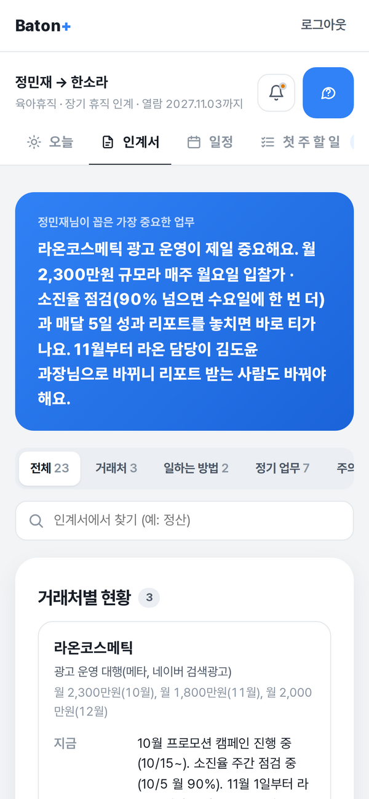
  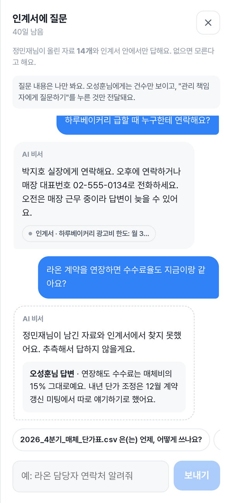

인수자는 이동 중에 확인하는 경우가 많아서 휴대폰 화면도 따로 맞췄습니다.

---

## 구조

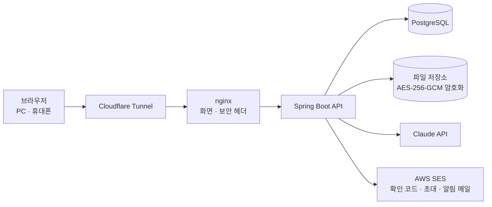

서버는 Oracle Cloud(도쿄) 한 대에 Docker Compose로 띄웠습니다. 서버에서 밖으로 열린 포트는 SSH 하나이고, 서비스는 Cloudflare Tunnel로만 들어옵니다.

---

## 설계할 때 신경 쓴 것

### 보안과 개인정보

회사 자료를 외부 서비스에 올리는 일이라 이 부분을 가장 먼저 정했습니다.

- 인계 공간 단위로 데이터를 나눴고, 인계자, 인수자, 관리 책임자, 검토자마다 볼 수 있는 범위가 다릅니다. 다른 인계의 자료를 볼 수 없는지는 통합 테스트로 매번 확인합니다.
- 원본 파일은 앱이 직접 AES-256-GCM으로 암호화해서 저장합니다.
- 보관 기간이 지나면 자동으로 지웁니다. 확정하지 않은 인계는 마지막으로 이용한 날부터 30일 뒤에 지우고, 7일 전과 1일 전에 메일로 알립니다. 개인정보처리방침에 적은 내용과 코드가 같은지 테스트로 확인합니다.
- 자료 안에 "이전 지시를 무시하라" 같은 문장이 있어도 AI가 따르지 않도록 자료를 지시와 분리해서 넘깁니다.
- 로그인, 검색, AI 질문, 내려받기는 접속 기록에 남기되 질문 내용은 남기지 않습니다.

### 긴 AI 작업은 백그라운드로

인계서 생성과 누락 점검은 자료가 많으면 1분을 넘깁니다. 그런데 Cloudflare는 100초가 넘는 응답을 끊어서, 서버는 끝까지 만들었는데 사용자는 오류를 보는 일이 생길 수 있었습니다. 요청은 바로 받아 두고 작업은 백그라운드에서 돌린 뒤, 화면이 몇 초마다 상태를 확인하도록 바꿨습니다.

AI 비용은 인계마다 사용량을 기록해 실제로 쟀고, 인계서 만들기와 점검은 인계 하나에 쓸 수 있는 횟수를 정했습니다. 크레딧이 떨어지거나 키에 문제가 생겨 AI가 멈추면 운영자에게 메일로 알립니다.

### AI 품질을 숫자로 확인

가상의 마케팅 대행사 자료 12개(카톡 3, 메일 3, 회의록과 엑셀 등 문서 6)와 정답지를 만들어, 실제 AI로 인계 한 건을 처음부터 끝까지 돌리고 채점했습니다. 지어낸 내용, 빠진 결재, 승인 규칙 누락 같은 큰 오류를 하나씩 고쳐 3건에서 0.7건으로 줄였습니다. AI만으로 안정되지 않는 부분(할 일 표 읽기, 완료 여부 판정, 인용 구절 확인)은 코드로 옮겼습니다.

### 배포 전 보안 점검

배포 전에는 전체 테스트와 보안 점검 스크립트를 돌리고, 심각한 문제가 없을 때만 배포합니다. 보안 점검은 실제로 들어가는 라이브러리 버전을 공개 취약점 DB(OSV)에 조회하고, 코드 규칙(비밀 값 커밋, 로그에 본문 기록 등)과 운영 서버 설정을 확인합니다.

이 과정에서 Apache Tika 취약점(CVE-2025-66516)을 찾았습니다. PDF 안의 양식에 외부 파일을 읽으라는 내용을 넣으면 서버 파일이 뽑아 낸 글에 섞여 나오는 문제였습니다. 공격용 PDF를 직접 만들어 실제로 새는 것을 확인한 뒤 업그레이드했고, 같은 테스트를 남겨 버전을 되돌리면 바로 실패하게 했습니다.

### 만들어 두고 운영에서는 꺼 둔 것

Slack, Gmail, Google Drive 연동, pgvector와 Ollama(bge-m3)를 이용한 의미 검색, "지난주 결정사항"처럼 날짜 표현을 확정하는 시간 파서도 개발했습니다. 지금 운영은 파일 업로드와 키워드 검색으로 하고 있고, 서버 사양과 외부 서비스 심사가 준비되면 켤 계획입니다.

---

## 회고

처음 이름은 Contix였고 방향도 달랐습니다. 인수인계 도구는 퇴사할 때만 써서 실패한다고 보고, 통화 메모나 문서 정리처럼 매일 쓰는 팀 도구를 만들면 인수인계 자료가 저절로 쌓일 거라 생각했습니다.

멘토링과 설문을 거치며 생각이 바뀌었습니다. 매일 쓰는 협업 도구는 이미 많았고, 인수인계가 정말 필요한 순간은 누군가 떠날 때 한 번이었습니다. 그래서 퇴사나 휴직 때 한 번, 약 한 달 쓰는 Baton+로 방향을 바꿨고, 그 한 번을 제대로 해내는 데 필요한 것에 집중했습니다. 빠진 일을 찾는 것, 근거 있는 답을 하는 것, 끝나면 깨끗하게 지우는 것입니다.
