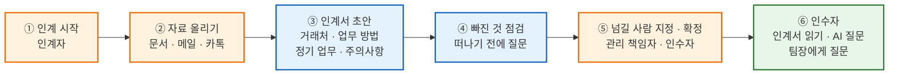

# Baton+ — 퇴사·휴직 인수인계 서비스

> **자사 서비스 · 2026.07 — 운영 중** · 정부 지원사업(사업화과제해결지원금) 선정 
> 서비스 [baton.2bee.dev](https://baton.2bee.dev) · 랜딩 [contix.io](https://www.contix.io)

인수인계서는 보통 **가장 바쁘고 덜 꼼꼼할 때**(퇴사·휴직 직전) 쓰입니다. 자체 설문에서 인수인계를 겪어 본 44명 중 **90.9%가 인수인계 뒤 재작업**을 경험했다고 답했습니다.

Baton+는 떠나는 사람(인계자)이 평소 쓰던 **문서·메일·카카오톡 대화**를 올리면 AI가 인계서 초안을 만들고, **인계서에서 빠진 일을 찾아 떠나기 전에 물어봅니다.** 받는 사람(인수자)은 인계서를 읽고, 근거가 붙은 AI 답변으로 질문하고, 모르는 건 팀장에게 남깁니다.

기획부터 백엔드·프론트엔드 개발, 배포·운영까지 **1인으로** 만들었습니다.

---

## 기술 스택

| 구분 | 기술 |
| --- | --- |
| Backend | Java 21, Spring Boot 3.5, Spring Security · JWT |
| Database | PostgreSQL (+ pgvector), Flyway 마이그레이션 51건 |
| Frontend | React 18, TypeScript, Vite |
| AI | Claude API (인계서 생성 · 누락 점검 · 근거 기반 답변), Ollama bge-m3 임베딩 |
| 파일 처리 | Apache Tika, 카카오톡 내보내기 파서(직접 구현) |
| Infra | Oracle Cloud, Docker Compose, Cloudflare Tunnel, AWS SES |
| 테스트 | JUnit 410건, 셸 기반 통합 시나리오 23종(검사 약 1,100건), Playwright |

---

## 서비스 흐름

인계 하나가 하나의 **인계 공간**입니다. 확정 전에는 인계자만, 확정 뒤에는 초대된 참여자만 볼 수 있고, 정해진 보관 기간이 지나면 자동으로 파기됩니다.

---

## 주요 기능

### 1. 자료 올리기 — 흩어진 업무 기록 읽기
- Apache Tika로 PDF · Office 문서, 메일 보관함(.eml · .mbox · Outlook .msg)을 읽습니다.
- 카카오톡은 공식 API가 없어서 **내보내기 파일 파서를 직접 만들었습니다** (Windows txt · Mac CSV). 인수자에게는 원본 대신 사적 대화를 걸러낸 **정리본**을 보여 줍니다.
- 파일 형식은 확장자가 아니라 **내용으로 판별**해 실행 파일·압축 파일은 거절합니다.

### 2. AI 인계서 초안
올린 자료를 Claude API로 읽어 **거래처 현황 · 일하는 방법 · 정기 업무 · 주의할 일**로 정리합니다. 항목마다 어느 자료에서 나왔는지 출처가 붙습니다.

### 3. 인수인계 누락 점검 — 이 서비스의 핵심
자료를 AI에 넣으면 요약은 됩니다. 하지만 **무엇이 빠졌는지**는 알려 주지 않습니다.
- 회의록의 할 일 표를 **코드로 읽어** 기한이 지난 항목을 찾습니다.
- 완료됐다는 말이 **담당자 본인의 발언**으로 남아 있지 않으면, 떠나기 전에 인계자에게 확인을 요청합니다.
- 인계자는 한 장씩 넘기며 빠른 답으로 채우고, 채운 답은 인계서의 근거가 됩니다.

### 4. 근거 기반 AI 답변 (RAG)
- 인수자의 질문에 **출처를 붙여** 답합니다.
- AI가 인용한 구절이 **원문에 실제로 있는지 코드로 다시 확인**하고, 답변의 숫자·날짜도 근거와 대조합니다.
- 평가 세트를 만들어 채점하며 고쳤습니다 — 큰 오류(지어냄 · 빠진 결재 · 승인 규칙 누락) **3건 → 0.7건**.

### 5. 보안 · 개인정보
- **인계 단위 데이터 격리**와 역할별 열람 권한 (인계자 · 관리 책임자 · 인수자 · 검토자)
- 원본 파일은 앱이 직접 **AES-256-GCM으로 암호화**해 저장
- 개인정보처리방침과 일치하는 **보관 기간 자동 파기** — 확정하지 않은 인계는 마지막 활동 30일 뒤 파기, 7일 · 1일 전 메일 안내
- 주민번호 · 카드번호 자동 가림, 프롬프트 인젝션 방어
- 로그인 · 검색 · AI 질문 · 내려받기 등 **접속 기록** (내용은 남기지 않음)

---

## 설계할 때 신경 쓴 것

### 1. 긴 AI 작업은 백그라운드로
인계서 생성과 누락 점검은 자료가 많으면 오래 걸립니다. 그런데 Cloudflare Tunnel은 **100초가 넘는 응답을 끊습니다.** 그래서 요청은 바로 받아 두고 작업은 백그라운드에서 돌리도록 바꿨습니다. 인계마다 AI 사용량을 기록해 **건당 비용을 재고 상한**을 걸었습니다.

### 2. 배포 전 자동 점검
배포 전에 테스트 전체와 보안 점검(OSV 기반 부품 취약점 스캔 · 코드 규칙)을 돌리고, 심각한 문제가 0건일 때만 배포합니다. 이 점검으로 Apache Tika 취약점(**CVE-2025-66516**, PDF를 통한 서버 파일 읽기)을 찾았고, **실제로 재현해 본 뒤** 업그레이드로 막았습니다.

### 3. 만들어 둔 연동과 검색
Slack · Gmail · Google Drive 연동, pgvector · Ollama(bge-m3) 의미 검색, "지난주 결정사항" 같은 날짜 표현을 확정하는 시간 파서까지 개발했습니다. 현재 운영은 **파일 업로드 + 키워드 검색**으로 하고 있습니다.

---

## 회고

처음 이름은 **Contix**였고, 방향도 달랐습니다. "인수인계 툴은 퇴사할 때만 써서 실패한다"고 보고, 통화 메모·문서 정리처럼 **매일 쓰는 팀 도구**를 만들면 인수인계가 부산물로 쌓일 거라 생각했습니다.

멘토 코칭과 설문을 거치며 생각이 바뀌었습니다. 매일 쓰는 협업 도구는 이미 많고, 인수인계가 정말 필요한 순간은 **누군가 떠날 때 한 번**이었습니다. 그래서 퇴사·휴직 때 한 번, 약 한 달 쓰는 **Baton+**로 방향을 바꿨고, 그 한 번을 제대로 해내는 데 필요한 것 — **빠진 일 찾기**, **근거 있는 답변**, 끝나면 **깨끗하게 지우기** — 에 집중했습니다.
