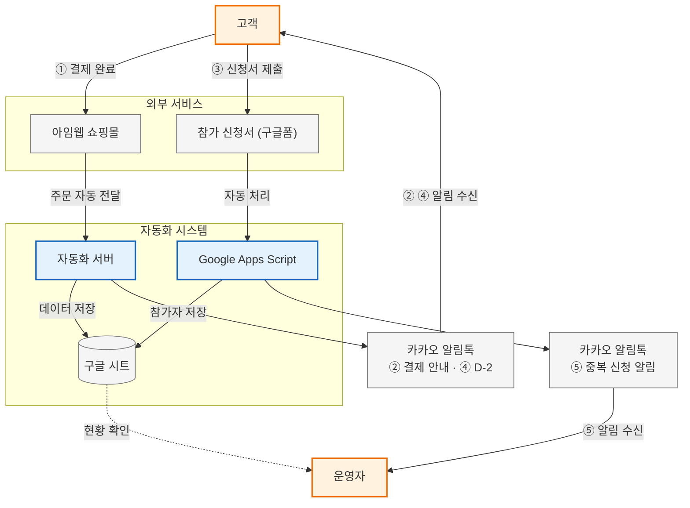
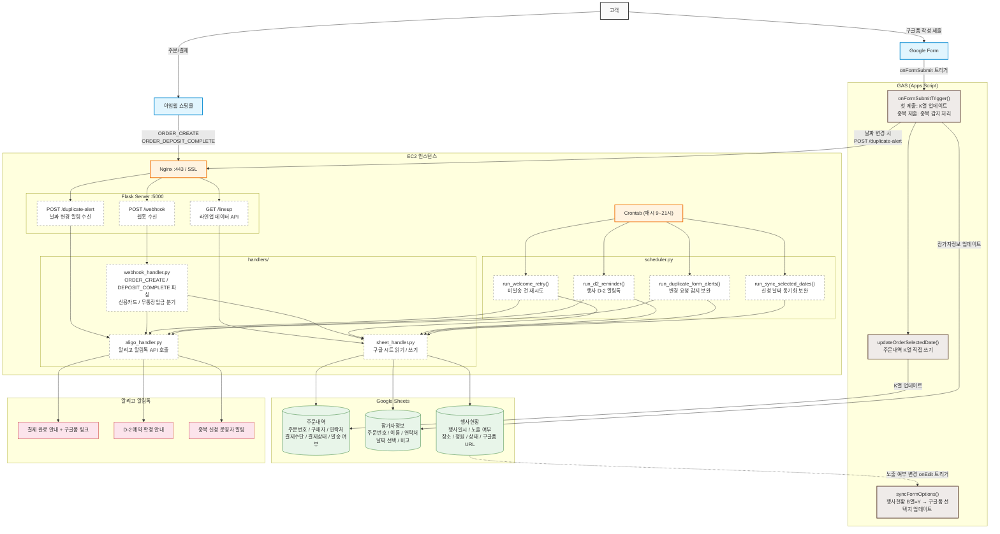
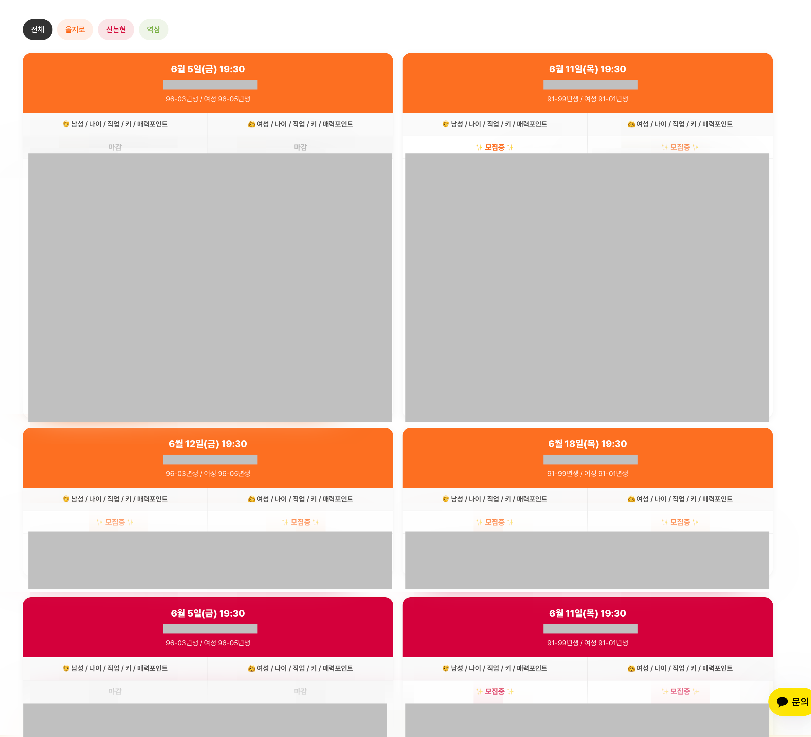
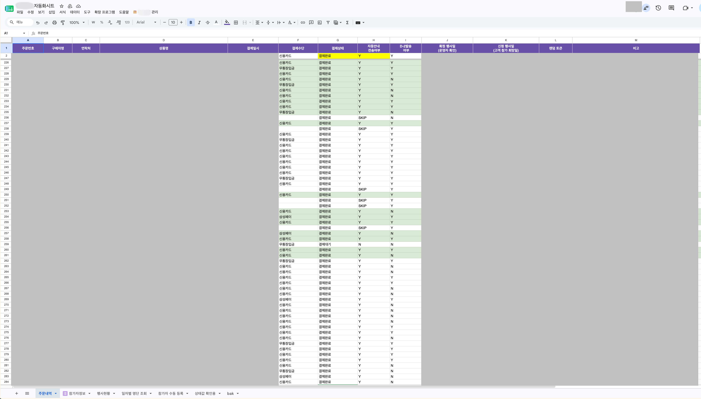
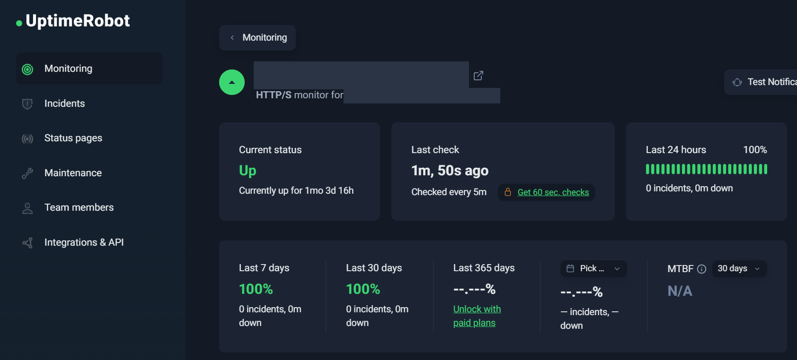

# 로테이션 소개팅 예약·운영 자동화

> 외주 · 2026.04 ~ 운영·유지보수 중 · 서버 셋업부터 혼자 진행

로테이션 소개팅 행사를 운영하는 고객사의 예약과 운영을 자동화한 백엔드 시스템입니다. 아임웹 쇼핑몰에서 결제가 들어오면 구글 시트에 주문을 기록하고, 카카오 알림톡으로 안내를 보내고, 참가 신청서와 참가자 명단까지 사람 손 없이 이어지도록 만들었습니다.

고객사 요청에 따라 서비스 이름과 도메인, 참가자 정보는 가렸습니다.

---

## 기술 스택

| 구분 | 기술 |
| --- | --- |
| Backend | Python 3.9, Flask, Gunicorn |
| Server | AWS EC2 (t4g), Nginx |
| Automation | Google Apps Script |
| External API | 아임웹 Webhook, 알리고 알림톡, Google Sheets API |
| Infra | systemd, crontab, Let's Encrypt SSL |

---

## 서비스 흐름



---

## 시스템 구조



---

## 주요 기능

### 1. 주문 자동화 (Webhook)

- 아임웹에서 주문이 들어오면 Webhook으로 받습니다.
- 신용카드로 바로 결제하면 안내 알림톡을 즉시 보내고, 무통장입금은 입금이 확인된 뒤에 보냅니다.
- 보내지 못한 건은 FAIL로 기록해 두고 크론이 다시 보냅니다.

### 2. 알림톡 자동화

- 결제 완료 안내와 함께 참가 신청서(구글폼) 링크를 보냅니다. 링크에는 본인 확인용 토큰이 들어갑니다.
- 행사 D-2, D-1, 당일 예약 확정 알림을 자동으로 보냅니다.
- 010-1234-5678처럼 형식이 제각각인 전화번호를 하나로 맞춘 뒤 보냅니다.

### 3. 구글 시트 연동

- 주문 정보를 자동으로 기록합니다.
- 구글폼 응답이 들어오면 참가자가 고른 날짜를 주문내역에 맞춰 넣습니다.
- 같은 사람이 신청서를 두 번 내면 감지해서 운영자에게 알림톡을 보냅니다.
- 운영자가 확정 행사일을 입력하면 참가자정보가 자동으로 바뀝니다(GAS onEdit).

### 4. 라인업 페이지 API

- 행사 목록과 참가자 현황을 지역별로 보여 주는 페이지에 데이터를 줍니다.
- 요청마다 Google Sheets API를 부르면 느리고 호출 한도에도 걸려서 5분 캐시를 두었습니다. 페이지가 빨라지고 시트 호출이 크게 줄었습니다.
- 요청이 한꺼번에 몰려도 캐시는 한 번만 다시 읽도록 잠금을 걸어, 같은 순간에 시트를 중복으로 읽지 않게 했습니다.
- 시트를 못 읽으면 직전 데이터를 대신 보여 줍니다.

### 5. 운영 도구 (Google Apps Script)

- 행사일 기준 참가자 명단을 성별과 결제 여부까지 넣어 메뉴 한 번으로 만듭니다.
- 운영자가 직접 입력하는 참가자 등록 시트를 두고, 주문내역과 참가자정보에 자동으로 이어 붙입니다.
- 행사현황에서 노출할 행사를 바꾸면 구글폼 선택지가 같이 바뀝니다.

---

## 기술적으로 고민한 것

### 서버를 EC2로 고른 이유

알리고 알림톡 API는 보내는 서버의 고정 IP를 등록해야 해서, 서버리스만으로는 쓸 수 없었습니다.

| 방식 | 고정 IP | 비용 |
| --- | --- | --- |
| Lambda + NAT Gateway | 가능 | 월 약 $35 |
| EC2 + Elastic IP | 가능 | 월 약 $5 |
| Lambda 단독 | 불가 | 알리고 사용 불가 |

EC2와 Elastic IP 조합을 골라 Lambda와 NAT를 쓰는 방식보다 비용을 약 87% 줄였습니다.

### 구글폼 토큰으로 본인 확인

신청서 링크에 주문번호를 넣으면 시트에서 바로 매칭할 수 있지만, 주문번호가 링크에 그대로 드러납니다. 주문이 들어올 때 16자리 무작위 토큰을 만들어 알림톡 링크에 넣고, 이 토큰으로 참가자를 매칭하도록 했습니다. 주문번호를 밖에 보이지 않고도 본인을 확인할 수 있습니다.

### Webhook이 실패해도 빠지지 않게

아임웹 Webhook은 실패했을 때 다시 보내 주는 횟수가 적어서, 받는 곳이 한 군데뿐이면 알림톡이 빠질 수 있었습니다.

```
1차: Webhook을 받는 즉시 발송
2차: 크론이 매분 미발송(N)과 실패(FAIL) 건을 다시 발송
```

네트워크 오류나 서버 재시작이 있어도 다음 크론에서 다시 보내도록 했습니다.

---

## 운영 모니터링

- 5분마다 RAM과 SWAP 사용량을 기록하는 로거를 백그라운드로 돌렸습니다.
- UptimeRobot이 5분마다 라인업 API를 확인하고, 서버가 멈추면 바로 알림을 보냅니다.
- SSL 인증서는 자동으로 갱신하고, 만료가 다가오면 Slack으로 알림이 옵니다.

---

## 트러블슈팅 기록

| 날짜 | 문제 | 조치 |
| --- | --- | --- |
| 2026-06-01 | Flask 디버그 모드로 돌던 서버가 메모리 부족으로 멈춤 | Swap 2GB 추가, Gunicorn 운영 모드로 전환 |
| 2026-06-02 | Gunicorn 워커 메모리가 계속 늘어날 위험 | `--max-requests 500`으로 워커를 주기적으로 새로 띄움, `gc.collect()` 호출 |
| 2026-06-03 | 라인업 페이지 요청마다 시트 API를 3번 불러 메모리 급증 | 5분 캐시와 잠금 적용, 시트 읽는 범위 축소 |
| 2026-06-05 | 워커당 메모리가 109MB에서 390MB까지 계속 증가 | Google Sheets API 클라이언트를 한 번만 만들어 재사용, 420MB에서 안정 |

---

## 트러블슈팅

### 메모리 누수

EC2 t4g.micro(RAM 1GB)에서 1~2시간마다 메모리가 800MB를 넘어 서버가 불안정해졌습니다.

```
재시작 직후   워커당 109MB
1~2시간 뒤    워커당 390MB (281MB 증가)
```

원인은 Google Sheets API 클라이언트(`build()`)를 요청마다 새로 만들던 코드였습니다. 워커마다 처음 한 번만 만들고 다시 쓰도록 바꿨습니다.

```python
# 전: 요청마다 새로 만듦
def _get_service():
    return build("sheets", "v4", credentials=creds, cache_discovery=False)

# 후: 워커당 한 번만 만들고 재사용
_service_cache = None

def _get_service():
    global _service_cache
    if _service_cache is not None:
        return _service_cache
    _service_cache = build("sheets", "v4", credentials=creds, cache_discovery=False)
    return _service_cache
```

| | 바꾸기 전 | 바꾼 뒤 |
| --- | --- | --- |
| 워커 메모리 (재시작 직후) | 109MB | 41MB |
| 오래 돌렸을 때 메모리 | 800MB 이상 (불안정) | 420MB (안정) |
| SWAP 사용량 | 382MB (계속 증가) | 48MB (고정) |

### 전화번호 앞자리 0이 사라짐

구글 시트가 전화번호를 숫자로 읽어 앞자리 0을 지웠습니다(01012345678이 1012345678로 바뀜). 보내기 전에 숫자만 뽑아 형식을 맞추고, 11자리인지 확인하도록 했습니다.

```python
# utils/validators.py
def normalize_phone(phone: str) -> str:
    digits = "".join(filter(str.isdigit, str(phone)))
    if digits.startswith("82"):
        digits = "0" + digits[2:]
    return digits

def is_valid_phone(phone: str) -> bool:
    return len(normalize_phone(phone)) == 11
```

---

## 스크린샷

### 라인업 페이지



### 주문내역 구글 시트



### UptimeRobot 모니터링



---

## 결과

- 주문이 들어와서 알림톡이 나가기까지 사람이 손대지 않아도 됩니다.
- 보내지 못한 알림톡은 자동으로 다시 보내서 빠지는 건이 없도록 했습니다.
- 서버 메모리를 800MB에서 420MB로 안정시켰습니다.
- 운영자가 손으로 하던 작업이 90% 넘게 줄었습니다.
