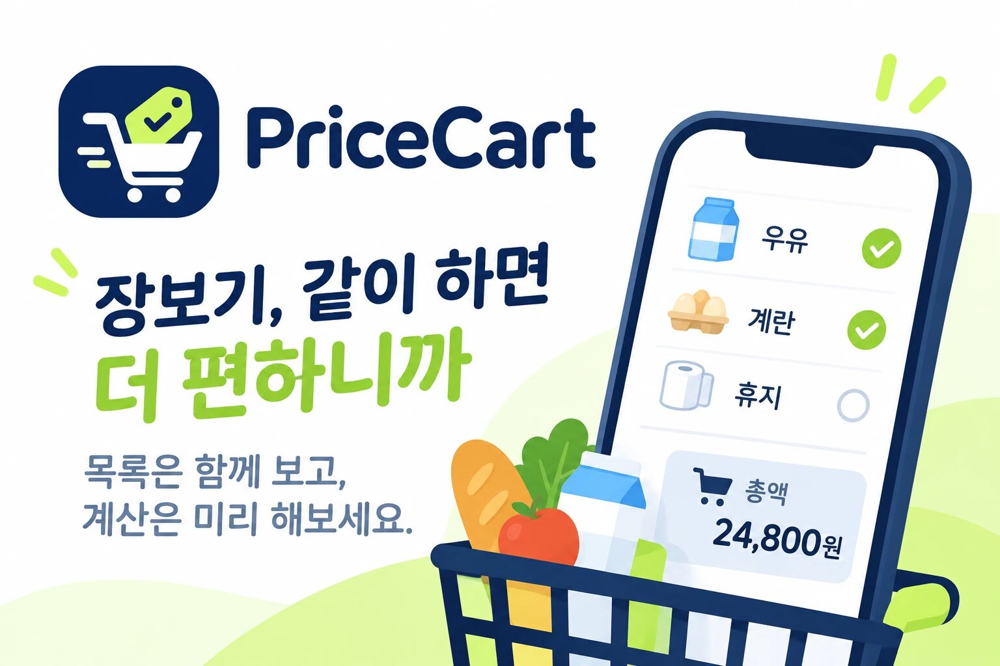
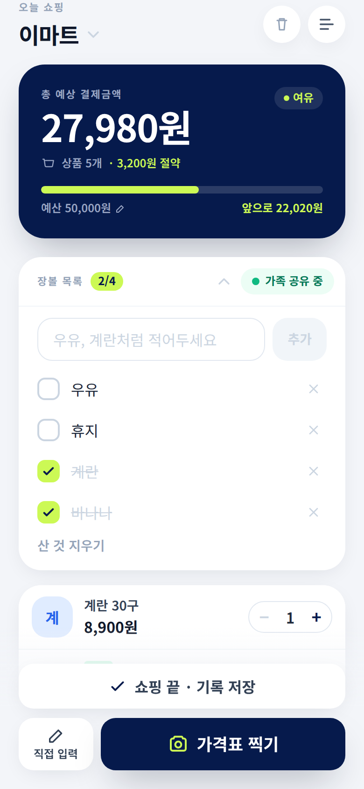
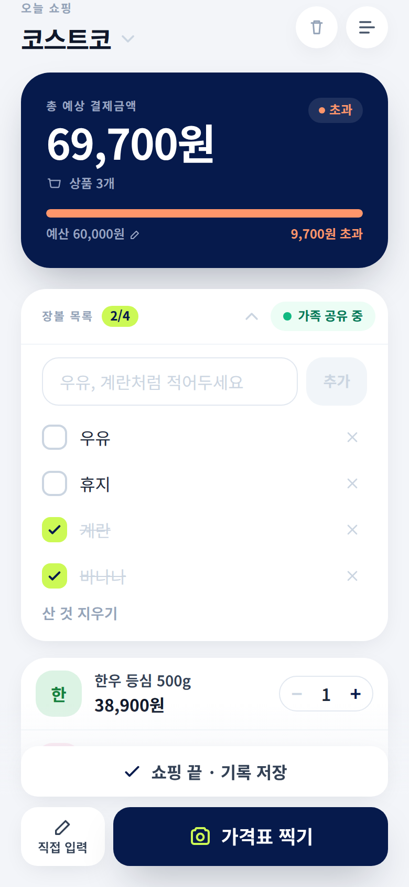
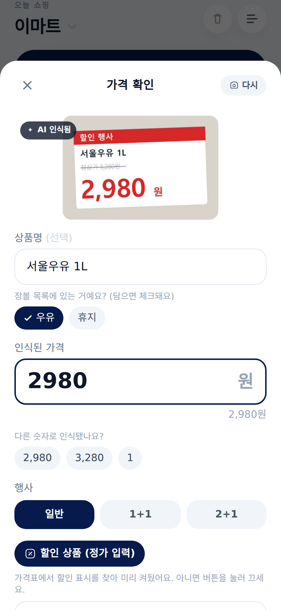
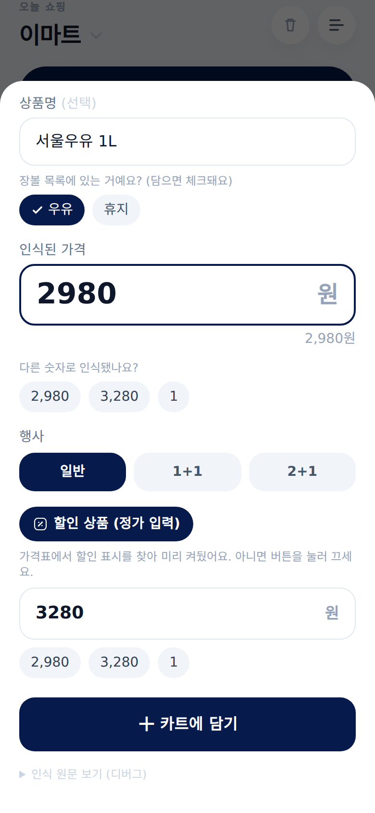
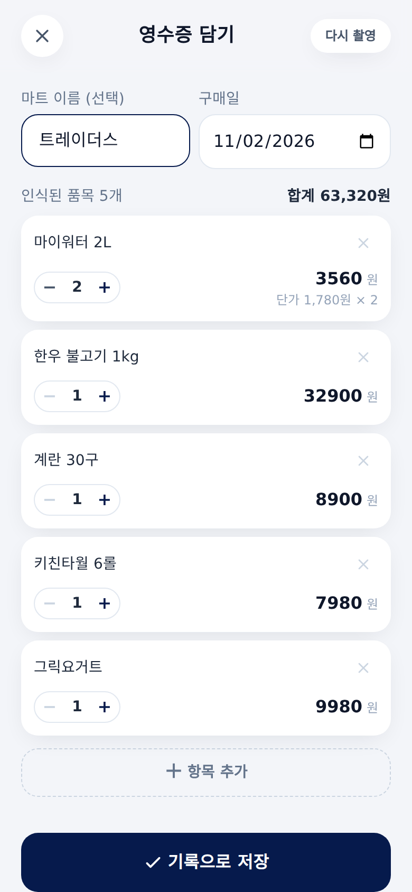
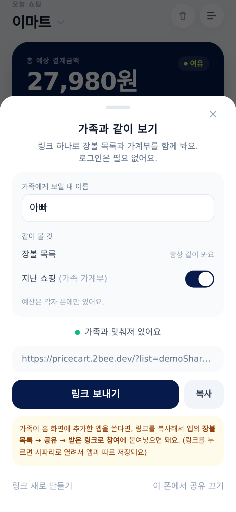
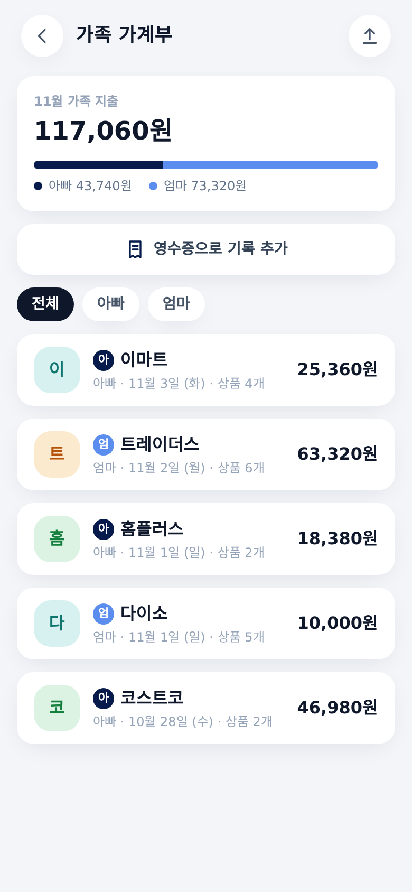
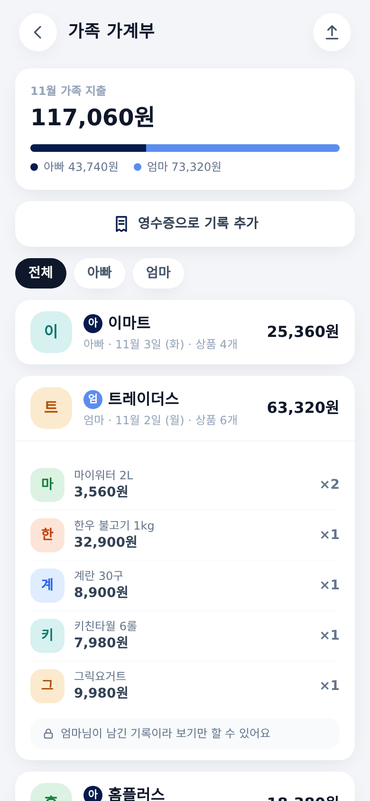
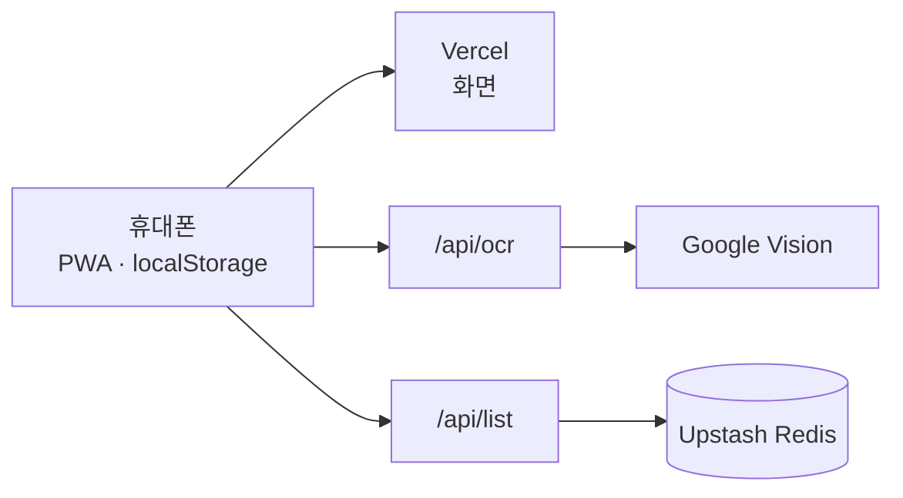

# PriceCart 장보기 계산기

> 개인 프로젝트, 2026.07 ~ 운영 중 (가족이 실제로 쓰고 있습니다) 
> 서비스 [pricecart.2bee.dev](https://pricecart.2bee.dev)

마트에서 장을 보다 보면 계산대에 가기 전까지 얼마를 썼는지 잘 모릅니다. 할인 상품, 1+1 행사, 정가가 섞여 있으면 머릿속으로 더하기도 어렵습니다.

PriceCart는 가격표를 찍으면 가격을 읽어 카트에 담고, 지금까지의 합계와 남은 예산을 보여 주는 웹앱입니다. 할인이나 1+1 행사는 가격표에서 찾아 미리 골라 둡니다. 장보기가 끝나면 기록으로 남기고, 영수증을 찍어서 기록할 수도 있습니다. 장볼 목록과 지난 쇼핑 기록은 링크 하나로 가족과 같이 봅니다.

처음에는 제가 쓰려고 만들었고, 지금은 가족이 같이 씁니다. 실제로 장을 보면서 불편했던 점을 하나씩 고쳐 온 프로젝트입니다.

화면에 나오는 상품과 금액은 시연용 데이터입니다.

---

## 기술 스택

| 구분 | 기술 |
| --- | --- |
| Frontend | React 18, TypeScript, Vite, Zustand, Tailwind CSS |
| 앱 형태 | PWA (서비스워커와 manifest 직접 작성, 홈 화면에 설치해서 사용) |
| Backend | Vercel Serverless Functions (Node.js) |
| OCR | Google Cloud Vision API, 오프라인일 때는 Tesseract.js |
| 저장소 | 기기 안 localStorage, 가족 공유는 Upstash Redis (Lua 스크립트) |
| 테스트 | Node 기반 시나리오 테스트, Playwright (화면 확인) |

---

## 화면으로 보는 기능

### 1. 담으면서 합계 보기

  
  

맨 위 카드에 지금까지 담은 금액이 크게 나옵니다. 예산을 정해 두면 진행 막대가 쓴 만큼 차오르고, 예산에 가까워지면 주황색, 넘으면 빨간색으로 바뀝니다. 계산대 앞에서 놀라지 않게 하는 게 이 앱의 첫 번째 목적이라, 가게 안에서 한눈에 알아볼 수 있는 쪽으로 만들었습니다.

1+1이나 2+1 행사 상품은 수량을 늘려도 무료인 개수만큼 빼고 계산하고, 할인 상품은 정가와의 차이를 아낀 금액으로 따로 보여 줍니다.

### 2. 가격표 찍기

  
  

가격표 찍기를 누르면 바로 카메라가 열리고, 찍으면 가격과 상품명을 읽어 확인 화면을 띄웁니다. 숫자를 잘못 읽었을 때를 위해 다른 후보 숫자도 같이 보여 줍니다.

가격표에서 "정상가 3,280원"이나 "-3,000원", "20% 할인" 같은 표시를 찾으면 할인 상품 버튼을 켜고 정가를 미리 채웁니다. 1+1, 2+1이 적혀 있으면 행사도 골라 둡니다. 잘못 켜지면 오히려 귀찮기 때문에, "100g당 2,580원" 같은 단가처럼 단순히 더 큰 숫자만 있을 때는 켜지 않습니다.

장볼 목록에 "우유"가 있고 찍은 상품이 "서울우유 1L"이면 목록의 우유를 미리 골라 두고, 카트에 담을 때 체크합니다.

### 3. 영수증으로 기록 남기기

가격표를 일일이 찍지 않고 장을 봤을 때는 집에 와서 영수증을 찍으면 됩니다. 상품명, 단가, 수량, 금액과 구매일을 읽어 기록으로 저장합니다. 영수증에 찍힌 상품이 장볼 목록에 있으면 그것도 체크합니다.

영수증은 마트마다 표 모양이 달라서 이 부분에 시간을 가장 많이 썼습니다. 아래 "만들면서 신경 쓴 것"에 자세히 적었습니다.

 

### 4. 가족과 같이 쓰기

  
  
  

공유 링크를 만들어 카카오톡으로 보내면, 받은 가족도 같은 장볼 목록을 보고 체크합니다. 한 사람이 체크하면 몇 초 안에 다른 사람 화면에도 반영됩니다. 로그인은 없습니다.

지난 쇼핑 기록도 원하면 가족 가계부로 같이 봅니다. 이번 달 가족 지출과 사람별 금액이 나오고, 기록마다 누가 남겼는지 표시됩니다. 가족이 남긴 기록은 볼 수만 있고 고치거나 지우는 건 쓴 사람만 할 수 있습니다. 예산은 각자 휴대폰에만 둡니다.

---

## 구조

카트, 기록, 예산은 서버 없이 휴대폰 안에만 저장합니다. 서버를 쓰는 곳은 두 군데뿐입니다. Vision API 키를 화면 코드에 넣지 않으려고 OCR 요청을 서버리스 함수로 대신 보내고, 가족 공유를 켰을 때만 목록과 가계부를 Redis에 둡니다.

---

## 만들면서 신경 쓴 것

### 가격표에서 가격 하나 고르기

OCR은 가격표의 글자를 전부 읽어 오기 때문에, 그중 어느 숫자가 판매가인지는 따로 골라야 합니다. 처음에는 가장 큰 숫자를 골랐는데 상품번호나 바코드가 뽑히는 일이 많았습니다.

그래서 숫자마다 점수를 매기도록 바꿨습니다. 판매가는 보통 가장 크게 인쇄되므로 글자 높이를 가장 큰 기준으로 두고, 천 단위 쉼표가 있으면 더하고, 쉼표 없는 여섯 자리 이상 숫자(상품번호)와 연도처럼 보이는 숫자, 앞에 마이너스가 붙은 할인액은 뺍니다. "11,9708"처럼 옆 글자가 붙어 읽힌 경우는 쉼표 뒤 정확히 세 자리까지만 가격으로 봅니다.

Vision API는 매장 안에서 인터넷이 안 될 때 쓸 수 없어서, 그럴 때는 휴대폰 안에서 도는 Tesseract.js로 대신 읽습니다.

### 영수증 표 읽기

영수증은 OCR 결과를 줄 단위 글자로 받으면 상품명 열과 숫자 열이 따로 떨어져 나와 어느 상품이 얼마인지 알 수 없었습니다. 트레이더스 영수증에서 특히 심했습니다.

Vision이 주는 단어별 좌표를 가지고 세로 위치가 비슷한 단어끼리 다시 한 줄로 묶었습니다. 그다음 "상품명" 머리글과 "합계" 사이만 품목으로 보고, 각 줄 오른쪽의 숫자들을 단가, 수량, 금액으로 나눴습니다. 숫자 순서가 영수증마다 달라서, 금액을 나누어떨어지게 하는 수량과 단가 조합을 찾는 방식으로 정했습니다.

다이소 영수증에서는 상품마다 붙은 바코드가 이름에 섞이고, 수량 1이 금액 앞에 붙어 "12,000"처럼 읽히는 문제가 있었습니다. 바코드 모양의 숫자는 먼저 걸러내고, 사진을 반듯하게 찍도록 안내했습니다.

### 로그인 없이 가족과 공유

가족끼리 장볼 목록 하나 같이 보자고 회원가입을 시키고 싶지 않았습니다. 그래서 추측할 수 없는 긴 무작위 주소(128비트)를 만들고, 그 링크를 아는 사람만 목록을 읽고 쓰게 했습니다. 링크가 엉뚱한 곳에 퍼지면 새 링크를 만들고, 옛 링크로 연결된 휴대폰에는 링크가 바뀌었다고 안내합니다.

두 사람이 동시에 고쳐도 꼬이지 않도록, 항목마다 더 나중에 고친 쪽이 남게 했습니다. 이 비교를 서버 코드에서 읽고 쓰면 그 사이에 다른 요청이 끼어들 수 있어서, Redis 안에서 Lua 스크립트로 한 번에 처리합니다. 지운 항목은 바로 없애지 않고 지웠다는 표시를 남겨야 다른 휴대폰에도 전달됩니다.

가계부를 붙이면서는 오가는 양을 줄이는 데 신경 썼습니다. 기록이 바뀔 때마다 서버가 번호를 하나씩 올리고, 휴대폰은 마지막으로 받은 번호 이후에 바뀐 기록만 받아 갑니다. 기록이 쌓여도 몇 초마다 오가는 데이터는 거의 없습니다. 남이 쓴 기록을 고칠 수 없게 하는 것도 화면에서 버튼을 숨기는 데서 끝내지 않고 서버에서 한 번 더 확인합니다.

공유 중이고 앱 화면이 켜져 있을 때만 4초마다 확인하도록 해서, Upstash 무료 한도(월 50만 번) 안에서 가족 여럿이 매일 써도 남도록 계산해 두었습니다.

### 아이폰에서 겪은 것

아이폰은 홈 화면에 추가한 앱과 사파리가 저장 공간을 따로 씁니다. 카카오톡으로 받은 공유 링크를 누르면 사파리로 열려서, 홈 화면 앱에는 연결이 안 되는 문제가 있었습니다. 링크를 복사해 앱 안에서 붙여넣어 참여하는 길을 따로 만들었습니다.

또 아이폰은 버튼을 누른 그 순간에만 공유 창을 열어 줍니다. 서버에서 링크를 받아 온 뒤 공유 창을 띄우면 막혀서, 링크를 만든 다음 "링크 보내기"를 한 번 더 누르도록 흐름을 나눴습니다.

### 시험 방법

가족 공유는 휴대폰 두 대가 있어야 확인할 수 있는 기능이라, 앱의 동기화 코드를 그대로 두 벌 띄워 아빠와 엄마 휴대폰처럼 주고받게 하는 시험을 만들었습니다. 참여, 체크 전달, 기록 수정과 삭제, 이름 변경, 남의 기록 덮어쓰기 거절, 링크 재발급까지 17가지 상황을 확인합니다. 배포한 뒤에는 실제 서버에 시험용 링크를 만들어 같은 흐름을 한 번 더 돌리고 지웁니다.

할인 자동 감지는 할인으로 봐야 하는 가격표 7가지와 보면 안 되는 가격표 7가지를 문장으로 만들어 두고, 규칙을 바꿀 때마다 돌립니다.

---

## 회고

처음 버전은 가격표를 찍어 더하는 계산기였습니다. 실제로 마트에서 써 보니 계산 말고도 필요한 게 보였습니다. 무엇을 사야 했는지 적어 둘 곳이 필요했고, 장을 본 뒤에는 얼마를 썼는지 남기고 싶었고, 그걸 같이 장을 보는 가족과 나누고 싶었습니다.

기능이 늘어도 처음 정한 것 하나는 지켰습니다. 서버는 꼭 필요한 곳에만 쓰고, 로그인 없이 바로 쓸 수 있게 하는 것입니다. 그래서 대부분의 데이터는 휴대폰 안에 두고, 가족 공유처럼 서버가 꼭 있어야 하는 기능만 서버로 옮겼습니다.

OCR 결과를 그대로 믿지 않는 것도 이 프로젝트에서 배운 점입니다. 인식은 Vision API에 맡기되, 읽어 온 글자 중에서 무엇이 가격이고 무엇이 할인인지는 직접 만든 규칙으로 판단하고, 애매하면 사용자가 고르게 했습니다.
